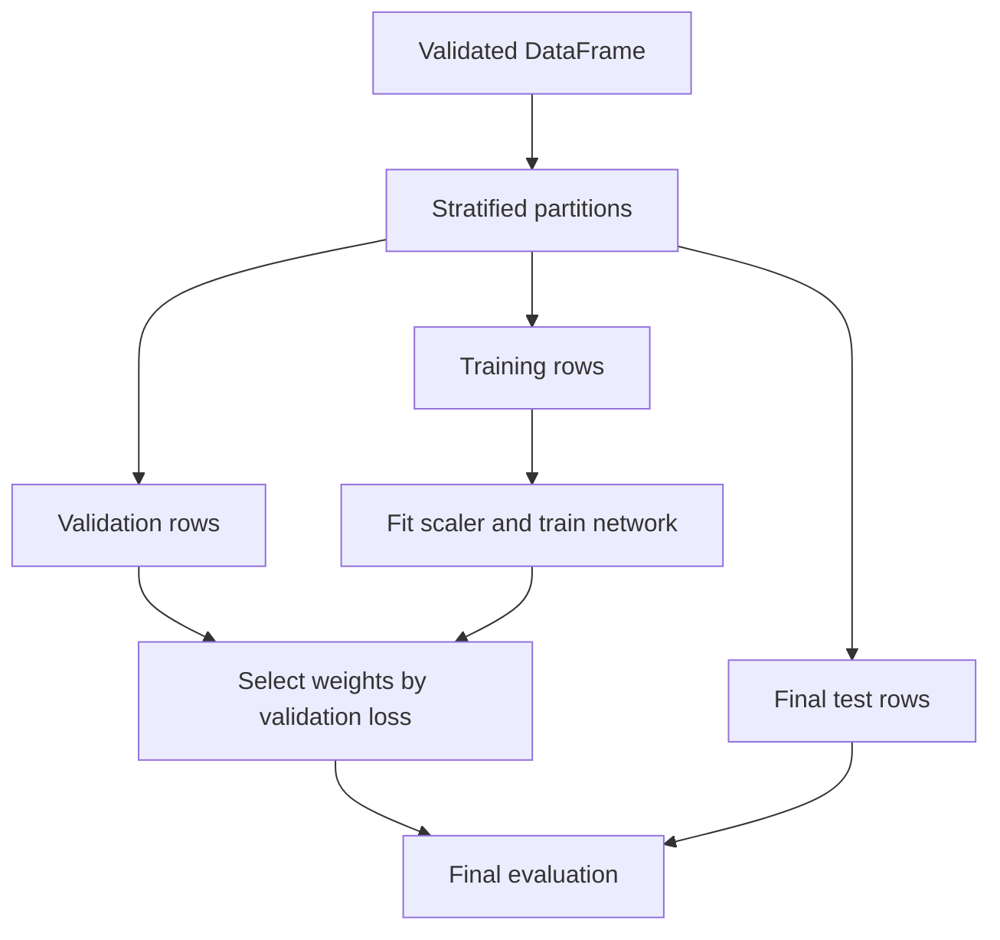

# Heart-Data Classification Experiment: project walkthrough

[Overview](../README.md) · [Code reference](CODE_REFERENCE.md) · [Development guide](DEVELOPMENT.md)

## Purpose and experiment design

The comparison changes which columns enter the model, rather than switching between unrelated algorithms. One run uses every column except `target`; the other uses `cp`, `slope`, `exang`, and `thal`. Both call the same data-splitting and model-building functions. A repeated seed gives the two feature sets the same row partitions, while the model weights still depend on the training process and execution environment.

## Repository map

| Path | Responsibility |
| --- | --- |
| [pr4.py](../pr4.py) | CLI, data checks, splitting/scaling, model construction, and experiment loop |
| [heart.csv](../heart.csv) | Bundled tabular input used by the checks |
| [heart.txt](../heart.txt) | Historical supporting material; the script reads the CSV, not this file |
| [requirements.txt](../requirements.txt) | Direct environment requirements |
| [tests/test_data.py](../tests/test_data.py) | Input rejection, repeatable splits, shapes, and training-data scaling checks |

## Functions and the objects they exchange

`load_data(path)` returns a pandas DataFrame. It requires `target` and the four selected feature columns, numeric finite values, no missing cells, and a binary target containing both 0 and 1. It rejects unsupported input rather than silently imputing values or changing the target definition.

`split_data(data, features, seed)` returns three `(features, labels)` pairs: training, validation, and testing. Twenty percent is held out for final testing, and twenty percent of the remaining training portion is held out for validation. The approximate overall split is therefore 64/16/20. Both splits are stratified by target. A `StandardScaler` is fitted on training features only; that scaler transforms all three partitions, and feature arrays are converted to float32.

`build_model(feature_count)` returns a compiled Keras Sequential model. An explicit input layer feeds two 64-unit ReLU dense layers and a single sigmoid output. The optimizer is Adam; the loss is binary cross-entropy; the reported metrics include accuracy and AUC. These settings describe the implementation, not evidence of clinical suitability.

`main()` reads `--data`, `--epochs`, and `--seed`, loads the data, and loops over the two feature lists. Early stopping monitors validation loss, waits up to ten nonimproving epochs, and restores the best weights before final test evaluation.

## Keep the test set outside fitting

The same training-fitted scaler transforms validation and test features. Neither held-out partition fits the scaler. Validation affects early stopping; the final test partition is reserved for the reported evaluation.

## Follow one run

`python pr4.py --epochs 20` reads the CSV adjacent to the script, independent of your original Windows folder. The epoch value is a maximum; early stopping can end a run sooner. Each feature set prints its name and a dictionary of test loss/metrics. No accuracy value is hardcoded into the documentation and no saved production predictor is created.

## Evidence and remaining work

The tests establish basic data and split behavior on the included file. A single-batch model check establishes limited TensorFlow compatibility. Full repeated-seed experiments, calibration, independent data validation, provenance/licensing checks, and external validation are not supplied. The dataset and historical repository name should not be read as institutional endorsement. See [development](DEVELOPMENT.md) for exact commands and limitations.
